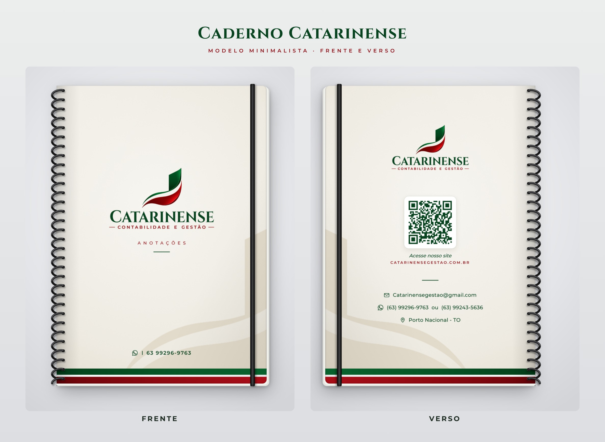
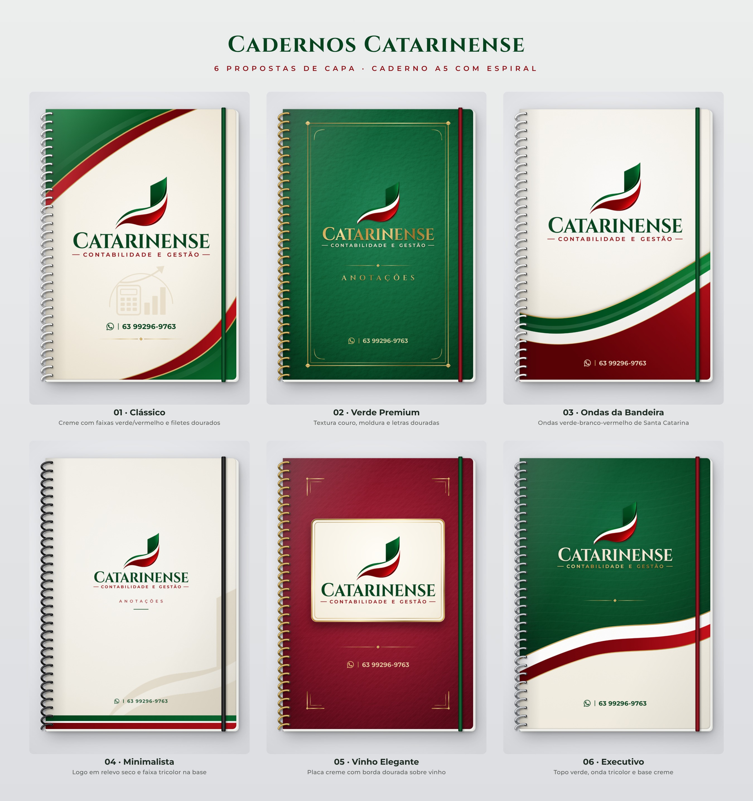

# Cadernos Catarinense: 6 propostas de capa

Capas de caderno de anotações com espiral para a **Catarinense Contabilidade e Gestão**, feitas a partir da logo oficial.

## ✅ Modelo escolhido: Minimalista (frente e verso)

Os arquivos finais estão em [`minimalista-frente-e-verso/`](minimalista-frente-e-verso/):



- `impressao/capa-frente.pdf|jpg` e `impressao/capa-verso.pdf|jpg`: A5 + 3 mm de sangria, 300 dpi.
- No verso, o espiral fica do **lado direito**, por isso os ~15 mm da direita ficam livres de texto.
- O QR code do verso leva para https://catarinensegestao.com.br/ (testado). Ele também está solto em `qr-code-site.png`.
- Contatos do verso: Catarinensegestao@gmail.com · (63) 99296-9763 ou (63) 99243-5636 · Porto Nacional - TO.

As outras 5 propostas abaixo ficam só como referência.



| # | Nome | Espiral / elástico sugeridos |
|---|------|------------------------------|
| 01 | Clássico (fiel à referência) | espiral branco · elástico verde |
| 02 | Verde Premium (couro + dourado) | espiral dourado · elástico vinho |
| 03 | Ondas da Bandeira | espiral branco · elástico verde |
| 04 | Minimalista | espiral preto · elástico preto |
| 05 | Vinho Elegante | espiral dourado · elástico verde |
| 06 | Executivo | espiral prata · elástico vinho |

## Pastas

- `mockups/`: caderno montado (espiral, elástico, sombra) para mostrar ao cliente ou postar.
- `capas-para-impressao/`: arte plana da capa para a gráfica, em **PDF** e **JPG**.
- `logo/`: logo com fundo transparente, mais duas versões para fundo escuro (texto creme ou dourado).
- `fonte/`: arquivos-fonte (HTML/CSS + scripts) para editar e gerar tudo de novo.

## Especificações para a gráfica

- Formato final: **A5, 148 × 210 mm**.
- Arquivo com **3 mm de sangria** em cada lado: **154 × 216 mm**, 300 dpi (1819 × 2551 px), RGB.
- Espiral à esquerda: os primeiros ~15 mm da borda esquerda ficam livres de textos e da logo (área dos furos).
- Elástico: no mockup, fica a ~10 mm da borda direita.
- A gráfica deve converter para CMYK. O verde e o vinho escuros podem mudar um pouco, então peça uma prova de cor.

## Regerar / editar (opcional)

Dentro de `fonte/` (precisa de Python 3 + Pillow, Node e Playwright):

```bash
python3 covers.py                 # gera os HTML das capas
node render_covers.js out         # capas em 300 dpi -> out/
node render_mockups.js out mock 2 # mockups -> mock/
```

O telefone fica na constante `PHONE`, no topo de `covers.py`.
