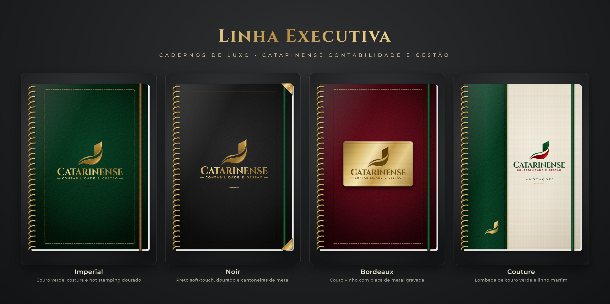

# Linha Executiva: cadernos de luxo

| Modelo | Acabamento sugerido | Espiral / elástico |
|---|---|---|
| **Imperial** | Couro sintético verde-escuro, costura dourada aparente, logo em hot stamping dourado | dourado / caramelo |
| **Noir** | Preto com laminação soft-touch, logo e filete em hot stamping dourado, cantoneiras de metal dourado nos cantos da direita | dourado / verde |
| **Bordeaux** | Couro sintético vinho, costura dourada, placa de metal dourado escovado com a logo gravada | dourado / verde |
| **Couture** | Meia-encadernação: lombada em couro verde com costura, painel em linho marfim, logo colorida | dourado / verde |

## Como produzir

São duas formas, conforme o orçamento:

1. **Capa impressa (mais barata):** mande para a gráfica o arquivo de `capas-para-impressao/` (A5 + 3 mm de sangria, 300 dpi), com capa dura e laminação soft-touch. A textura de couro, a costura e o dourado saem impressos.
2. **Couro de verdade (mais chique):** peça capa em couro sintético na cor do modelo, costura de verdade e **hot stamping** (dourado aplicado a quente) da logo. Para fazer o clichê do hot stamping, a gráfica usa o arquivo `hot-stamping-logo-preto.png`. Se ela pedir vetor, mande o arquivo original da logo (AI/PDF/SVG) de quem criou a logo.
   - Noir: as **cantoneiras de metal** são uma peça física, não saem impressas no arquivo.
   - Bordeaux: a **placa de metal** pode ser encomendada à parte (placa gravada a laser e colada). Na versão impressa, ela já está desenhada na capa.

Os arquivos-fonte (para regerar) estão em `../../cadernos-catarinense/fonte/` (`luxo.py`, `make_mono.py`, `mockup.html`).
