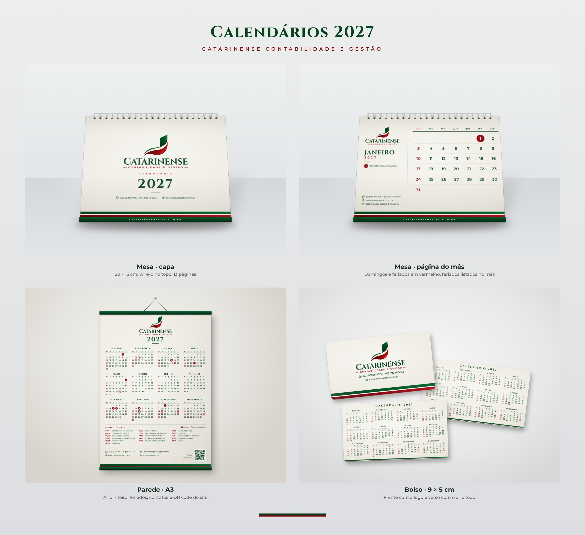

# Calendários 2027: Catarinense Contabilidade e Gestão



Mesmo estilo do caderno minimalista: fundo marfim, logo colorida, verde e vermelho da marca, faixa tricolor na base. Sem dourado.

## Modelos e arquivos para a gráfica (`impressao/`)

| Modelo | Tamanho final | Arquivo |
|---|---|---|
| **Mesa** (wire-o no topo, base de papelão) | 20 × 15 cm, 13 páginas (capa + 12 meses) | `calendario-mesa-2027-13-paginas.pdf` (as páginas soltas estão em `mesa-paginas/`) |
| **Parede** | A3 (29,7 × 42 cm) | `calendario-parede-a3.pdf` / `.jpg` |
| **Bolso** | 9 × 5 cm, frente e verso | `calendario-bolso-frente` e `calendario-bolso-verso` (`.pdf` / `.jpg`) |

- Todos em 300 dpi com sangria: 3 mm nos de mesa e parede, 2 mm no de bolso.
- Mesa: os ~15 mm de cima ficam livres para os furos do wire-o. A base verde com "CATARINENSEGESTAO.COM.BR" aparece só no mockup; é uma sugestão para a gráfica imprimir na base.

## Feriados marcados

Domingos em vermelho. Feriados com bolinha vermelha cheia; pontos facultativos com bolinha só com contorno. No de bolso, os feriados vêm em vermelho sublinhado.

- **Nacionais:** 01/01, 26/03 (Paixão de Cristo), 21/04, 01/05, 07/09, 12/10, 02/11, 15/11, 20/11 (Consciência Negra) e 25/12.
- **Pontos facultativos:** Carnaval (08 e 09/02) e Corpus Christi (27/05).
- **Tocantins (TO):** 18/03 (Autonomia), 08/09 (N. Sra. da Natividade) e 05/10 (Criação do Estado).

> Os feriados municipais de Porto Nacional **não** foram incluídos. Antes de imprimir, confira se quer acrescentar algum e se os estaduais estão corretos.

## Regerar

Arquivos em `fonte/` (use dentro da pasta de trabalho, com `assets/` e `fonts/` de `cadernos-catarinense/fonte/`):

```bash
python3 calendarios.py       # gera os HTML em cal/
node render_cal.js cal_out   # páginas em 300 dpi
node render_cal_mock.js cal_mock 1.5
```

Os feriados ficam no dicionário `FERIADOS`, no topo de `calendarios.py`.
